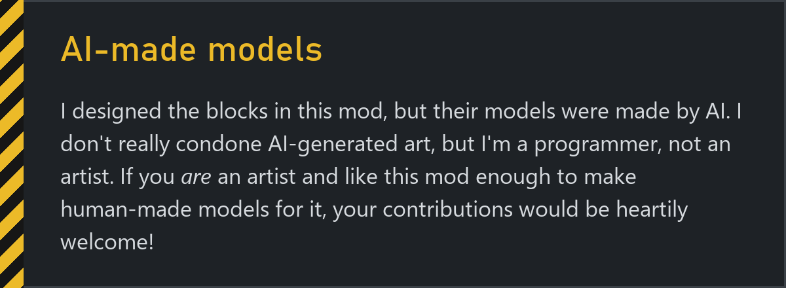

# Sprocket Programmable Block

Sprocket Automation's take on the programmable block. It's a _real_ programmable block, so every script you already use works on it, screens and all.

## Blocks

Large grid only.

- **Sprocket Programmable Block**: a slim device that mounts on a wall by its back.
- **Sprocket Programmable Block Inset**: a full, airtight block with the same device set into its front. Mounts on any side.

Both show up in the G menu as variants of the vanilla programmable block, right next to Keen's own.

## Sprocket Automation

This is a perfectly fine programmable block all on its own. It doesn't need anything else.

It does carry the name for a reason, though. Add **Sprocket Automation** and your ship's automation runs right here, without a single line of script: logic systems with triggers that run their steps in order, waiting on what your blocks are actually doing (a door that's actually closed) instead of on timers. Sprocket lives in every programmable block on the ship, so losing one doesn't lose your logic, and a backup can restore it to a new ship.

## Building the models



The models are built by scripts, so they can be built again from this repository alone.

You need:

- Blender 4.5.
- The Space Engineers Utilities add-on (SEUT) for Blender, with its asset library set in its preferences. SEUT's export also needs the Space Engineers ModSDK.

Steps:

1. `Assets/build_models.py` builds both variants, the keyboard tray and its screen, and exports them to `Assets/Build`. SEUT's export needs a window, so run it in a normal Blender, not with `-b`:

   ```
   blender.exe --no-window-focus --window-geometry 0 0 800 600 --python Assets/build_models.py
   ```

2. `Assets/Tools/derive_stages.py` derives the LODs and build stages from that blend, following `Assets/Stages/stages.txt`. Run it windowed as well:

   ```
   blender.exe --no-window-focus --window-geometry 0 0 800 600 Assets/Build/SprocketProgrammableBlock.blend --python Assets/Tools/derive_stages.py -- --stages Assets/Stages/stages.txt --out <folder>
   ```

3. Copy `<folder>/Content/Models/Cubes/large/*.mwm` into `SprocketProgrammableBlock/Content/Models/Cubes/large`.

Both scripts quit Blender when done and write a log beside their output. The textures' sources are in `Assets/Textures`. `Assets/make_logo.py` draws the logo and black glass textures again, with Chrome and texconv (from the ModSDK). Set `CHROME` and `TEXCONV` if they are installed elsewhere.

## License

Released under the MIT License, in [LICENSE.txt](SprocketProgrammableBlock/LICENSE.txt). Before publishing your own copy, please consider contributing here instead, so players know where each bug and feature lives and reports reach the right authors.
